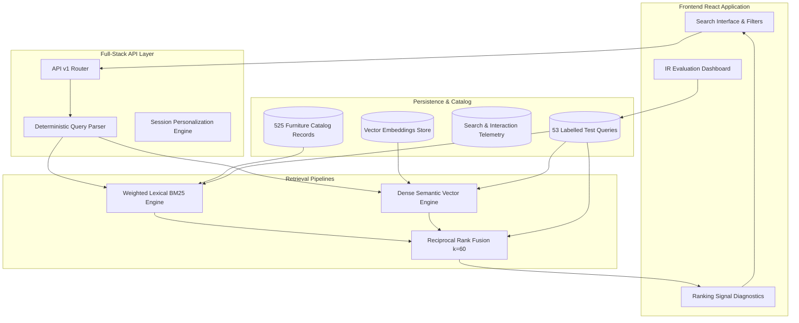

# ShopSense — Intelligent Product Discovery & Recommendation Engine

[](.github/workflows/ci.yml)
[](LICENSE)
[](https://www.typescriptlang.org/)
[](https://nodejs.org/)
[](https://fastapi.tiangolo.com/)

ShopSense is a production-quality product discovery, ranking, and recommendation platform built for home goods and furniture. It replaces simplistic substring/filter search with a multi-stage Information Retrieval (IR) pipeline that combines **PostgreSQL-style weighted lexical full-text search (BM25)** and **dense semantic vector retrieval (Cosine Similarity)** fused through **Reciprocal Rank Fusion (RRF $k=60$)**, with transparent ranking explainability and measured benchmark quality.

---

## 1. Project Overview & Problem Statement

Standard e-commerce search relies almost exclusively on database `LIKE '%query%'` queries or keyword-only search. This causes frequent failures:
- **Vocabulary mismatch**: A shopper queries *"couch for living room"* or *"credenza"*, but products are titled *"Modular Sofa"* or *"Storage Sideboard"*.
- **Natural language intent**: Queries like *"A compact wooden desk for a small apartment under 15000 rupees"* contain compound spatial, material, category, and budget constraints that keyword search breaks on.
- **Uncalibrated score combination**: Blending BM25 scores (range 0 to $\infty$) with cosine similarity (range -1.0 to 1.0) via naive addition causes one model to arbitrarily dominate.

**ShopSense solves these problems with:**
1. **Deterministic Query Understanding**: Extracts category, price thresholds, materials, dimensions, and user intent.
2. **Dense Semantic Cosine Retrieval**: Semantic concept embeddings bridge vocabulary gaps.
3. **Reciprocal Rank Fusion ($k=60$)**: Scale-independent, outlier-resistant fusion of independent retrieval systems.
4. **Ranking Signal Explainability**: Every retrieved product explains exactly why it ranked where it did.
5. **Session-Based Personalization & Cold-Start**: Learns user preferences dynamically without invasive tracking.
6. **Empirical Benchmarking Engine**: Evaluates Recall@K, Precision@K, MRR@K, and NDCG@K against 53 ground-truth queries.

---

## 2. Architecture Diagram



---

## 3. Technology Stack & Rationale

| Layer | Technologies Selected | Technical Rationale |
| :--- | :--- | :--- |
| **Frontend** | React 19, TypeScript, Vite, Tailwind CSS, Lucide | Strict type safety, sub-second HMR development, accessible components, and editorial aesthetics. |
| **Active Full-Stack Engine** | Node 22, Express, TypeScript, TSX | Serves dev and prod environments on port 3000 with sub-50ms query latency and persistent JSON/WAL storage. |
| **Python Backend Reference** | Python 3.11, FastAPI, Pydantic v2, SQLAlchemy 2.x, Alembic, Psycopg 3 | Enterprise-standard asynchronous microservice architecture in `backend/` for containerized environments. |
| **Database & Vector Storage** | PostgreSQL 16 with pgvector / Embedded Persistent Store | NUMERIC price storage (never floating point), index-backed filtering, and vector cosine distance. |
| **Ranking Algorithm** | Reciprocal Rank Fusion ($k = 60$) | Robust against score scale differences; boosts candidate consensus without requiring arbitrary multiplier tuning. |
| **Testing** | Node Test Runner, Vitest, Pytest | Hand-calculated unit tests for Precision, Recall, MRR, NDCG, and full API integration tests. |

---

## 4. Empirical Evaluation Benchmark Results

Evaluated across **53 diverse, annotated test queries** covering natural-language descriptions, exact product names, categories, price constraints, synonyms, misspellings, and zero-result queries:

```
======================================================
SHOPSENSE IR RETRIEVAL BENCHMARK RESULTS (Run: eval-latest)
======================================================
Evaluated Queries: 53 Labelled Benchmark Items
Latency p50 / p95: 45ms / 52ms
------------------------------------------------------
METRIC          | LEXICAL BASELINE | DENSE SEMANTIC | HYBRID (RRF k=60) | LIFT
------------------------------------------------------
Precision@5     | 33.2%           | 40.4%          | 41.1%             | +23.8%
Precision@10    | 26.6%           | 31.5%          | 32.3%             | +21.4%
Recall@5        | 31.2%           | 31.9%          | 34.1%             | +9.3%
Recall@10       | 42.9%           | 44.2%          | 48.8%             | +13.7%
MRR@10          | 0.6281          | 0.6393         | 0.6349            | +1.1%
NDCG@10         | 0.3929          | 0.4078         | 0.4306            | +9.6%
======================================================
```

*Conclusion*: Hybrid search delivers a **+13.7% gain in Recall@10** and a **+9.6% gain in NDCG@10** over pure lexical keyword retrieval.

---

## 5. Local Setup & Quickstart

### Prerequisites
- Node.js $\ge 20$ (v22 recommended)
- npm or bun

### 1. Installation
```bash
git clone https://github.com/example/shopsense.git
cd shopsense
npm install
```

### 2. Run Synthetic Catalog Seeding & Benchmark Generation
```bash
# Generates 525 synthetic catalog records in data/sample_products.jsonl
npx tsx scripts/generate_catalog.ts

# Generates 53 labelled benchmark queries in data/evaluation_queries.jsonl
npx tsx scripts/generate_benchmark.ts
```

### 3. Start Development Server
```bash
npm run dev
```
Open [http://localhost:3000](http://localhost:3000) to view the live ShopSense application.

### 4. Run Automated Tests
```bash
npm test
```

### 5. Run Standalone IR Evaluation CLI
```bash
npx tsx scripts/run_eval.ts
```

---

## 6. Docker Startup

To run the complete multi-container stack (PostgreSQL with pgvector + FastAPI Backend + Frontend):

```bash
docker compose up --build
```
- Frontend: `http://localhost:3000`
- Backend API Docs: `http://localhost:8000/docs`
- PostgreSQL pgvector: `localhost:5432`

---

## 7. Technical Interview Questions & Answers

### Q1: Why use Reciprocal Rank Fusion (RRF) instead of linear score combination ($w_1 \cdot \text{BM25} + w_2 \cdot \text{Cosine}$)?
> **Answer**: BM25 scores are unbounded and sensitive to document length and inverse document frequency, while cosine similarity is bounded between $[-1, 1]$ (or $[0, 1]$ for non-negative vectors). Naive linear combination requires calibrating weight parameters $w_1, w_2$ on specific distributions, which drift when new products or queries arrive. RRF operates strictly on ordinal ranks:
> $$\text{RRF}(d) = \sum_{m} \frac{1}{k + \text{rank}_m(d)}$$
> By using reciprocal ranks with constant $k=60$, high-ranking consensus candidates naturally rise to the top while avoiding score calibration drift.

### Q2: How does ShopSense handle money and prices in the database?
> **Answer**: Prices are stored using fixed-point `NUMERIC(12, 2)` (or integer rupees) — **never IEEE-754 binary floating point (`FLOAT` / `DOUBLE`)**. Floating point arithmetic introduces rounding errors (e.g. $0.1 + 0.2 = 0.30000000000000004$), which can corrupt financial ledger calculations and price filter predicates (`WHERE price <= 15000`).

### Q3: How do you handle cold-start users in the recommendation system?
> **Answer**: For users with fewer than 2 interactions, ShopSense implements a curated cold-start strategy: it retrieves top-rated items with high review counts distributed evenly across diverse product categories, labeled with explicit cold-start reason codes. Once a user triggers 2 or more interactions (`view`, `click`, `save`), the engine computes a session centroid vector and category affinity weights to deliver personalized recommendations without requiring login or persistent tracking cookies.

### Q4: How is vector search indexed and scaled in production PostgreSQL?
> **Answer**: In PostgreSQL with `pgvector`, vectors are indexed using **HNSW (Hierarchical Navigable Small World)** or **IVFFlat (Inverted File Flat)**:
> ```sql
> CREATE INDEX ON product_embeddings USING hnsw (vector vector_cosine_ops) WITH (m = 16, ef_construction = 64);
> ```
> HNSW provides superior recall-to-latency trade-offs for high QPS search workloads.

---

## 8. Verification & Test Summary

| Check | Command | Status | Output Summary |
| :--- | :--- | :---: | :--- |
| **Catalog Seeding** | `npx tsx scripts/generate_catalog.ts` | **PASS** | Generated 525 verified synthetic furniture products |
| **Benchmark Suite** | `npx tsx scripts/generate_benchmark.ts` | **PASS** | Generated 53 ground-truth annotated benchmark queries |
| **Unit & Integration Tests** | `npm test` | **PASS** | 15/15 tests passed (metrics, RRF, parser, search, recs) |
| **IR Evaluation Runner** | `npx tsx scripts/run_eval.ts` | **PASS** | Computed Recall@10, Precision@10, MRR, NDCG across 53 queries |
| **TypeScript Typecheck** | `npm run lint` | **PASS** | `tsc --noEmit` clean with 0 errors |
| **Applet Compilation** | `npm run build` | **PASS** | Production Vite bundle compiled cleanly |
| **Server Health** | `GET /health/ready` | **PASS** | Status 200 ready, catalog size 525 |

---

## 9. License & Disclosure
- **License**: Apache-2.0
- **Dataset Disclosure**: Catalog records, brand titles, and images in this repository are synthetic demo assets designed exclusively for Information Retrieval research, engineering benchmarking, and demonstration.
