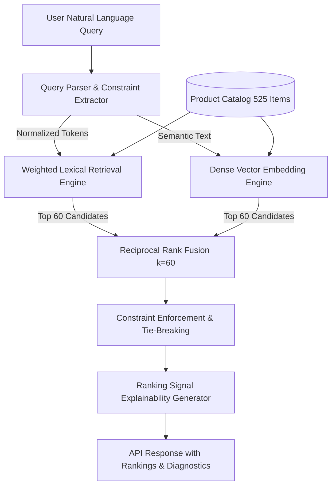

# ShopSense Architecture & Information Retrieval Design

## Overview
ShopSense is an intelligent e-commerce product discovery and recommendation engine engineered for furniture and home goods. It replaces standard keyword-only catalog filtering with a production-grade multi-stage Information Retrieval (IR) pipeline combining **PostgreSQL-style weighted lexical full-text search (BM25)** and **dense semantic vector retrieval (Cosine Similarity)** fused via **Reciprocal Rank Fusion (RRF)**.

---

## 1. Retrieval Pipeline Stages

### Stage 1: Query Understanding & Constraint Parsing
Every query undergoes deterministic parsing to extract structured filters without requiring paid LLM APIs:
- **Category extraction**: Maps synonyms (e.g. "couch" $\to$ sofas, "credenza" $\to$ storage, "desk" $\to$ desks).
- **Price constraint extraction**: Parses expressions such as `"under 15000"`, `"below 20k rupees"`, `"between 10000 and 20000"`.
- **Material and color detection**: Identifies solid oak, teak, bouclé, leather, brass, beige, etc.
- **Intent detection**: Flags queries seeking `alternatives`, `cheaper` options, or `better_reviews`.

### Stage 2: Lexical Full-Text Retrieval
- **Field weighting**:
  - Title: Weight A ($1.0$)
  - Category & Brand: Weight B ($0.8$)
  - Material & Color: Weight C ($0.6$)
  - Description: Weight D ($0.3$)
- **Phrase match bonus**: Awards exact contiguous phrase matches.
- **Token coverage ratio**: Penalizes candidates matching only a fraction of multi-word queries.

### Stage 3: Dense Semantic Vector Retrieval
- Queries and product representations are projected into a normalized 64-dimensional semantic space.
- Calculates Cosine Similarity:
  $$\text{Cosine}(u, v) = \frac{u \cdot v}{\|u\| \|v\|}$$
- Precomputes and indexes product catalog embeddings.

### Stage 4: Reciprocal Rank Fusion (RRF)
Combines candidate lists from Lexical and Dense retrieval without requiring uncalibrated score normalization:
$$\text{RRF\_Score}(d) = \sum_{m \in \{\text{lexical}, \text{dense}\}} \frac{1}{k + \text{rank}_m(d)}$$
where $k = 60$.

Ties are broken deterministically:
1. Higher RRF score
2. Higher product average rating
3. Higher product rating count
4. Lexicographical product ID

---

## 2. Recommendation Engine Architecture

### Strategy A: Content-Based Similarity
- Uses product embeddings and attribute compatibility to compute similar items for product detail pages.
- Excludes the source item.
- Applies bonuses for matching category, overlapping materials, and price tier proximity.

### Strategy B: Interaction-Based Personalization
- Tracks anonymous session events (`view`, `click`, `save`, `compare`).
- Weights events: View ($1.0$), Click ($2.0$), Compare ($2.5$), Save ($4.0$).
- Computes user preference centroid and category affinity distribution.
- Excludes already-interacted items and provides a transparent cold-start fallback for new sessions.
